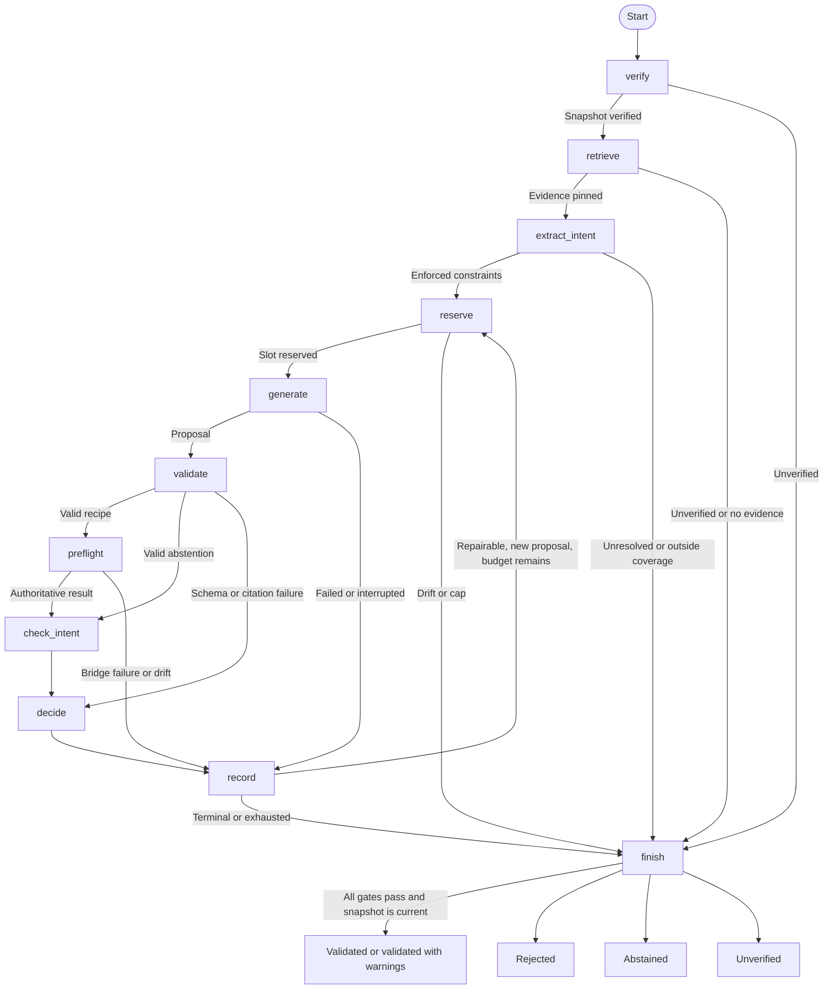

# ADR 0004 — Bounded LangGraph orchestration for MPML

**Status:** Designed in M4A. M4B-1 provides the offline skeleton.
Live generation and repair integration are planned for M4B-2.

M3.5 recorded clean preflight alongside wrong intent in 3 Qwen, 2 Gemma, and
4 Llama cases. It also found representation failures that could be corrected
without changing the request. M4B will add a small, optional LangGraph workflow
around the existing M2 retriever, M3 generator and validators, and MPML bridge.
Use Qwen2.5-Coder 7B for initial development based on the recorded comparison.
[Baseline findings](../evaluation/M3_5_GENERATION_BASELINE_FINDINGS.md)

## Nodes and transitions

| Node | Work and transition |
| --- | --- |
| Verify | Resolve trusted source configuration. Check the index against the live spec and source snapshot using the existing retrieval provenance check. Capture the index fingerprint, source revision, dirty state and spec hash. On failure finish `unverified`. |
| Retrieve | Reuse M2 rankings and the existing M3 evidence projection. Verify the snapshot used by retrieval matches the verified one. Pin the retrieved chunks and citation IDs for the run. Abstain on insufficient evidence. Preserve a source or retrieval infrastructure failure as `unverified`. |
| Extract constraints | Parse a small supported subset of explicit requirements from the original question and cross-reference option names against the live spec. Freeze the constraints and source spans. Finish `abstained` if an essential identifier is missing, requirements conflict, a capability is unsupported, or a material requirement cannot be resolved. |
| Generate | Reserve one model call, then invoke the M3 structured generator against the question and pinned evidence. Repair uses this same node with bounded feedback. A model availability, transport, timeout or model identity failure stops the run as `unverified`. A malformed candidate may enter repair. |
| Validate structure | Reuse Pydantic, allowed option-shape and env-key checks, and citation resolution against the pinned retrieved set. Verify abstention shape and reason. A well-formed abstention goes to the intent node without preflight. A recipe goes to preflight only after all structural and citation checks succeed. |
| Preflight | Recheck source/index provenance. Call the existing MPML bridge with the candidate's exact ordered argv and unchanged overrides in the trusted cwd and inherited environment. Save all issues and the exit code. Recheck provenance afterward. A source or bridge failure finishes `unverified`. A well-formed rejection still goes to the intent node so the graph can distinguish the exact requested invalid candidate from a substitution. |
| Check intent | Compare the candidate with the frozen constraints independently of preflight. Apply the terminal or repair decision below. Withhold release on an unresolved material requirement or unverified activation. |
| Finish | Recheck provenance before releasing a command. Only a structurally valid, grounded candidate with successful preflight and consistent explicit constraints may reach the existing shell-escaped manual renderer. Return diagnostics and the reason for any other disposition without a command. |

The verify and retrieve steps may share the checked snapshot from
`retrieve_context`. Every new candidate goes through structural validation,
citation resolution and, if eligible, preflight and intent checks. Keep terminal
states `validated`, `validated_with_warnings`, `rejected`, `abstained`, and
`unverified`. Release warnings directly from MPML. Earlier attempts retain their
errors and warnings even if a later candidate passes.

## M4B-1 state transitions

The skeleton injects trusted source verification, retrieval, generation,
structural validation and preflight callbacks. Tests use scripted proposals and
reuse the existing validation helpers. The graph itself only marks a candidate
as eligible for release. Command rendering and live callback wiring belong to
M4B-2. An authoritative rejection is terminal in M4B-1. The retry loop exercises
structural failures classified as retryable and explicit intent violations after
successful preflight. There is no model-generated repair feedback in this slice.

The initial extractor accepts anchored phrases for strategy and pair selection,
repeated flags, defaults, exact pair overrides, selected CLI/env exclusivity
and precedence patterns, and explicit PhaseAware roles. Unknown values stay
available for MPML to reject. Quoted examples, negations, qualifiers, ambiguous
references and unsupported wording produce no extracted constraints. Requests
outside coverage abstain in the skeleton. Passing the checks establishes
consistency with the recorded source spans only.

## Three validation boundaries

**A. Structural and evidence validation.** The existing Pydantic and option-shape
checks cover candidate structure, flag spelling, representation, and allowed
environment keys. Citation validation resolves each prompt ID to the same
retrieved chunk and checks support for each proposed setting using the existing
mention check. A citation can identify evidence without proving the free-text
explanation. Evidence, candidate text, user input and diagnostic text are data.

**B. MPML preflight.** Only the existing allowlisted spec and preflight interfaces
may be called. The graph passes the exact candidate and records the authoritative
report. MPML owns value validation, registry roles, precedence rules and diagnostic
severity. Argus does not recreate those rules. A clean result leaves experiment
success, DL activation and artifact loading unverified.

**C. Explicit intent consistency.** Use an immutable list of typed constraints
with the source span from the original question. An M4B constraint needs a known
target, an operator and an operand:

| Target | Supported assertions |
| --- | --- |
| Strategy flags | Explicit identifiers and multiplicity. Require order when the user states it. |
| Pair selection | Explicit pair identifiers or CSV selection. Require stated order. Compare only supported normalization from the spec. |
| Option or env key | Require a declared channel, key and value. CLI-only or env-only excludes the equivalent setting on the other channel. Preserve both when the user explicitly requests precedence. |
| Additional settings | Require a named key or prohibit a named key or option family. An explicit defaults-only selector request prohibits adding that selector. |
| Substitution | An exact selection or explicit no-substitution requirement fixes the value and role, including an invalid role. |
| Information or capability | Record an essential missing identifier, explicit conflict, or a request for an unsupported operation or proof. |

Only anchored, unambiguous patterns may produce enforced constraints. For
example, “TF4 followed by MR32, in that order” fixes an ordered list, and “seed 123
using the CLI only” fixes both value and channel. A quoted example, negated
setting, reference to a prior conversation, or unresolved wording requires
interpretation before enforcement. Extractors must distinguish these contexts or
leave the requirement unresolved. Evidence can identify the option that maps to
an explicit request. It cannot supply the user's missing strategy choice. Model
inferences are advisory and cannot mutate the enforced constraints. M4B should
start with narrow patterns exhaustively covered by fixtures and abstain on
unresolved material ambiguity. Absence of a supported constraint for a material
part of the request is not a pass. Report constraint checks and unresolved spans.
`intent_consistent` means the extracted assertions were met. Full semantic intent
and runtime success remain unverified.

## Repair and terminal policy

| Failure | Decision |
| --- | --- |
| Invented CLI flag or invalid argument shape | Repair only when the original request has a grounded, supported representation. Otherwise reject the candidate without release. |
| Env setting encoded as a CLI flag | Repair using the verified spec inventory and retain the exact requested channel and value. |
| Missing or malformed abstention fields | If a deterministic blocker is established, emit an Argus-authored abstention with that factual reason and no candidate. Otherwise allow structural repair with the original question if the intent is resolvable. |
| Missing or unintentionally repeated strategy arguments | Repair against the required list, multiplicity and order. Retain intentional repetitions. |
| Incorrect PhaseAware role substitution | Repair back to the requested role only when the exact requirement can still be checked. If authoritative preflight rejects the exact requested role, return that rejection or abstain. Never switch roles or pick a replacement. |
| Unrequested strategy or duplicate CLI/env setting | Repair when it conflicts with an extracted prohibition such as defaults-only or CLI-only. If the constraint is ambiguous, abstain. |
| Contradictory requirements or missing essential identifier | Abstain with the conflict or missing detail. If authoritative preflight has already rejected the exact requested configuration, that rejection may be returned. |
| Unsupported broker action | Abstain immediately when identified. No repair or tool call may attempt the operation. |
| DL activation or artifact-loading proof | Abstain when proof is requested or activation remains unverified. Preserve actual preflight findings, including strict boolean or alias diagnostics. Never change the DL value to obtain release. |
| Fabricated, unsupported or missing citations | Repair only with the already retrieved, verified evidence and a factual citation failure reason. Abstain if support is absent. |
| Authoritative preflight rejection | Return `rejected` for an exact invalid request. Repair only an identified representational defect when correction preserves all constraints. Keep the original rejection in the attempt history. |
| Stale evidence, source/index or model drift, malformed or unavailable preflight, generation transport failure or timeout | Stop `unverified`. Source integrity and infrastructure errors are non-retryable within the graph. |

Allow at most **two additional generation attempts** after the initial one.
Reserve a call by incrementing an Argus-owned counter before each invocation,
including invocations that fail. Both the repair router and generation node
enforce a maximum of three reserved calls. Neither model output nor graph state
emitted by the model may reset the counter. Repair requires a classified
repairable defect, a verified fixed snapshot, a resolvable intent, and time
remaining under the run deadline. The graph stops when the budget expires, a
terminal condition occurs, or a repair repeats the same candidate and failure.
On repair exhaustion or repetition, finish `rejected` for structural or
authoritative rejection and `abstained` for otherwise valid candidates that
violate intent. Finish `unverified` when a run deadline or graph step ceiling
prevents completing the gates. Neither path renders a command. Use existing
bounded component timeouts within the finite run deadline.

Pass the original request, fixed retrieved excerpts, frozen constraints, and a
bounded projection of the previous candidate and diagnostics to the generator.
Use only relevant field names, offending values, issue codes and capped messages.
Exclude tracebacks, credentials and unrelated environment values. A failed
attempt remains failed. A repair may produce a distinct passing candidate after
all checks. It cannot alter diagnostic severity, reuse a prior success, or
silently relax the request.

## Typed state and deployment boundary

Use one in-memory state per invocation. Keep node inputs typed and separate from
model-controlled candidate content. The minimal shape is:

- `Request`: original question, trusted source/model configuration and deadline.
- `Snapshot`: source SHA, dirty flag, spec hash, index fingerprint and the
  retrieved evidence IDs with citation metadata and bounded excerpts.
- `Intent`: immutable constraints, their original spans and unresolved items.
- `Attempt`: ordinal, current candidate, A/B/C outcomes, exact preflight
  diagnostics, bounded feedback and stage timings. Keep an append-only attempt
  list of at most three entries.
- `Accounting`: reserved attempts, actual model-call count, monotonic elapsed
  wall time, repair count and terminal reason.
- `Result`: disposition, explicit intent status, resolved citations, raw warnings
  and optional manual command text.

The graph has no LLM tool bindings, arbitrary filesystem access, network
services beyond the existing local Ollama path, persistent agent memory, or
experiment execution. It never launches `main.py`, generated commands, artifact
loading, or brokerage operations. M4B should expose the graph as an explicit
opt-in with a lazy optional LangGraph import. Default `argus ask` and the historical
M3 evaluator remain single-pass. If the graph is requested without the extra,
give an actionable dependency error. Other commands continue to work.

M4B should test graph routing and call budgets offline with synthetic generator
and preflight responses. The main unresolved risks are false confidence from
over-broad extraction, unnecessary abstention from narrow patterns, and the
latency of extra model calls. Defer holdout claims to M4C.
[Evaluation protocol](../evaluation/M4_EVALUATION_SPEC.md)
