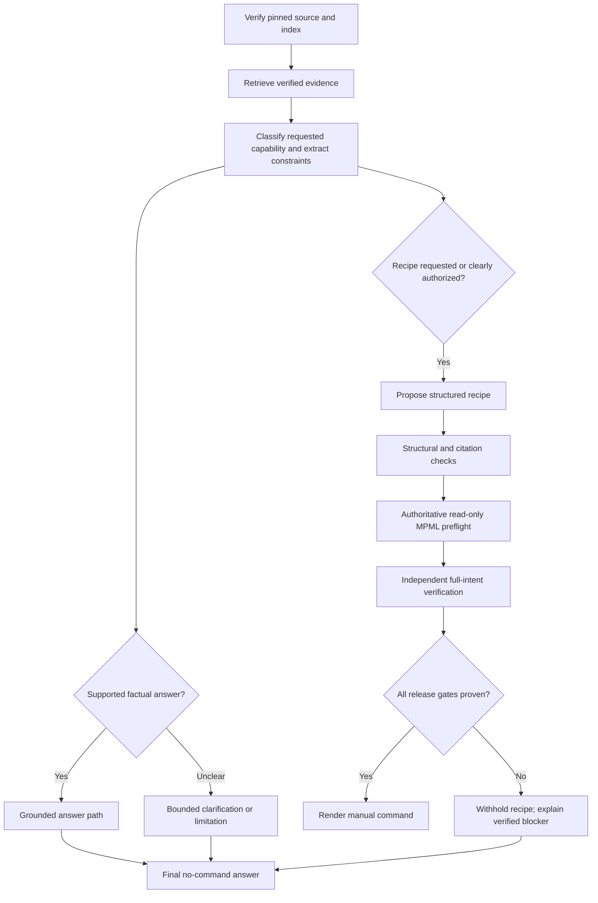

# Argus M4 v2 — Capability-aware routing and verified response contracts

**Status:** Proposed architecture, not implemented or evaluated  
**Date:** 2026-11-26  
**Repository:** `jalmqvist/argus-cli`  
**Scope:** Read-only MPML assistance; no execution of experiments, broker actions or generated commands.

## 1. Decision and research basis

Design M4 v2 around **two separately authorized outputs**:

1. **Evidence-grounded answer:** explain an MPML launch capability, constraint, precedence rule, diagnostic or limitation *without releasing a runnable command*. Useful responses may give documented setting names or conceptual examples, but an actionable complete recipe is a separate release decision.
2. **Verified launch recipe:** release the exact proposed argv/env as a manually executable MPML command **only after independent structural, citation, user-intent and authoritative MPML preflight gates pass**. An accepted preflight is necessary but not sufficient.

The routing decision should not require `intent.extract()` to produce a fully `enforced` intent before *any* model call. However, **unknown or unverified material intent must never silently become permission to release**.

Evidence behind this proposal:

- The 12-case registered `holdout-v1` machine subset: M3 7 pass / 4 fail / 1 review, M4 v1 0 pass / 12 fail. M4 made **zero** model calls, because its coverage gate rejected all cases before generation. The M3 results include incorrect proposals; coverage alone is not correctness.
- The 14-question manual subset: M3 2 correct / 6 partial / 6 incorrect, M4 v1 14 incorrect (all explanation-free early abstentions). M3 released some misleading proposals. The reviewer awarded M4 safety/epistemic credit for withholding but not task completion.
- These are **consumed diagnostic data**, not an untouched post-change holdout. The two scoring regimes must remain separate; no combined success percentage or post-hoc scorer edits.

**Hypothesis, not a result:** More permissive *answer routing* plus constrained candidate generation and strict *command release* can reduce false withholding without losing safety.

## 2. Current implementation: precise failure mechanism

At the current `main` branch (verify before implementation):

- `src/argus_cli/intent.py::extract()` uses anchored `re.fullmatch` patterns. It returns `enforced`, `unresolved` or `not_covered`, and `check()` compares the frozen constraints to proposed argv/env.
- `src/argus_cli/agent.py::build_graph()` has the path `verify → retrieve → extract_intent → reserve → generate`. At `extract_intent`, `coverage != "enforced"` immediately terminates as `abstained`. That makes the model, structure checks, preflight and repair inaccessible to naturally worded requests.
- `src/argus_cli/live_agent.py` projects `candidate.explanation` only if a candidate survives structural validation. Early withholding consequently has `explanation: null`.
- `src/argus_cli/generation.py::Candidate` has only `outcome=recipe|abstain`; there is no dedicated explanatory answer type. `src/argus_cli/ask.py` and the agent share limited citation checks (correct retrieved IDs and *mention* of proposed settings), but a citation alone does **not** prove the correctness of a natural-language claim.
- `src/argus_cli/ask.py::_validate_options()` allows only `launch_selector` env overrides to become candidates. This is sensible for command release; explanations must nevertheless be able to discuss **non-launch-selector**, diagnostic and source-edit-only settings without treating them as approved env overrides.
- `src/argus_cli/cli.py` currently returns exit code 0 for `argus ask` only when `command != null`; explanatory success must not be conflated with command-release success.

These are architectural facts, not claims about LLM reasoning quality.

## 3. Outcome and authorization contract

The [v2.0 response and routing contract](M4_V2_RESPONSE_CONTRACT.md) and [offline acceptance fixtures](../../eval/m4v2/README.md) specify the initial schema and test boundaries.

Keep user-facing status and verification orthogonal. Prefer an explicit result schema with distinct fields rather than making `verification=validated` mean both "good answer" and "safe command".

| Field | Proposed meaning |
| --- | --- |
| `response_kind` | `answer`, `recipe`, `rejection_explanation`, `abstention` or `unverified` |
| `answer_status` | `grounded`, `limited`, `withheld`, or `unverified`; **never** implies MPML execution or full semantic truth |
| `recipe_status` | `not_requested`, `withheld`, `rejected`, `validated`, `validated_with_warnings`, `unverified` |
| `command` | Non-null **only** after all command release gates pass; never present for answer-only output |
| `argv`, `env` | For released recipes: exact final tokens/overrides. For unapproved proposed candidates: retain in private attempt trace, not as user-facing ready-to-run settings |
| `answer` / `explanation` | Relevant factual response, including when `command=null`, with bounded source citations and explicit limitations |
| `issues` / `preflight` | Exact authoritative observations if preflight actually ran. Never synthesize a probe result |
| `intent_coverage` | `enforced`, `partial`, `unresolved`, `not_covered`, plus reasons/spans; a description, **not** a release verdict |
| `material_constraints_status` | `verified`, `unresolved`, `contradicted` for the *entire* requested command, not only the constraints the extractor happened to recognize |

**Backwards compatibility:** Existing machine reports and M3/M4-v1 scorers remain frozen. If callers require legacy `verification`, map recipe-only outcomes consistently, but add a new explicit v2 schema/version and evaluator. Do not silently reinterpret archived fields. A grounded answer may have `command=null` and an intentional nonzero CLI exit under the old contract; in v2 define/document appropriate exit codes separately (e.g. success for delivered answer; failure for unavailable/invalid request), without making exit 0 imply command authorization.

### Examples of allowable outcomes

- “How do I disable automatic analysis; what is the default?” → `answer`, name `MPML_AUTO_ANALYZE=false`, default true, cite spec; **no generated MPML command** unless explicitly requested and checked.
- “Can I use a source-edit-only spread setting from the environment?” → `rejection_explanation`, explain source-edit-only limitation, no env candidate and no command.
- “Set `DL_SIGNALS_ENABLED=yes` — does that enable DL?” → `answer`: strict boolean parsing treats `yes` as false; distinguish the observed `ENV_BOOL_PARSED_FALSE` warning from a successful activation proof; no activation claim.
- “Generate a launch command with variant C/seed 817/output pilot-c” → candidate path. Every requested setting must be represented exactly, checked against spec, citations and preflight; output path availability remains a preflight-time observation.
- “Use invalid PhaseAware role MR2 as TF” → answer the *requested* invalid condition, with exact preflight rejection if actually probed; never replace it with a different strategy to achieve success.
- “Place a broker order” → deterministic unsupported-capability response, no tool action and no command.

## 4. Capability-aware graph



This is a conceptual state machine. In code, handle all edges—including `unverified` infrastructure failures, repaired proposals and mixed answer/recipe requests—explicitly, rather than allowing parallel graph branches to overwrite shared fields.

### 4.1 Route classification is advisory, never command authority

Introduce a typed `RequestAnalysis` independent of the model's candidate:

- `requested_capabilities`: explanation, configuration lookup, precedence, diagnostic interpretation, recipe construction, impossible/unsupported request, ambiguous or unsafe action. Multiple categories may coexist.
- `explicit_requirements`: exact requested values, roles, channels, multiplicity, ordering, negation, restrictions, defaults and prohibited substitutions, with original spans.
- `missing_information`: values genuinely needed to construct the requested command, not mere lack of a full-string regex match.
- `coverage`: detailed partial matches and unknown spans.
- `authority`: `answer_allowed`, `recipe_candidate_allowed`, `recipe_release_eligible` (initially false until all gates pass).

A model may propose an interpretation **but cannot certify** that every material requirement was recovered. Treat low coverage as *answer-or-withhold*, not as an unconditional pre-generation failure; the exact bar for a released command is deliberately higher.

### 4.2 Intent coverage and complete-command checking

Do **not** simply turn `Intent("not_covered")` into `Intent("enforced", ())`: `check()` on an empty constraint set would vacuously pass.

Two workable v2 strategies:

**Preferred:** Build a bounded, typed *request plan* with a deterministic extraction layer for recognizable explicit values plus a bounded model-assisted interpretation of residual text. Require an independent review/validator to certify all material spans (including negative requirements, precedence and scope) before command release. Source spans must refer to the **original question**, not invented values. If independence or completeness cannot be established, answer without a command or ask for one missing essential value.

**Conservative initial implementation:** Keep existing narrow extractor as sufficient for automatic recipe release, but allow unsupported phrasings to enter the **answer path** and read-only spec lookup. Add targeted generalizable intent representations in later PRs, backed by fresh development examples. This produces a measurable improvement in explanatory coverage without pretending that arbitrary natural language is safely understood.

Do not use model agreement with itself or a self-reported confidence number as independent certification. A second LLM pass may generate audit evidence but **does not alone** meet the command-release invariant.

### 4.3 Grounded answer path

For high-confidence spec lookups, prefer deterministic source-derived facts and concise templates (supported flags/env vars, documented defaults, precedence, source-edit-only status, known preflight issue descriptions). Use the existing `inspect`/`explain` primitives where appropriate.

For broader natural-language explanations, permit constrained generation that:

- cites verified chunks by ID, checks that cited IDs belong to the pinned retrieval result and that relevant settings are cited;
- separately labels documented facts, observed read-only diagnostics and unverified assumptions;
- is checked for **supported settings** and obvious contradictions, but does **not** claim semantic entailment is mechanically established by the current mention-based citation validator;
- does not print fake launch syntax or supply invented values as an actionable configuration;
- never turns a source-edit-only or diagnostic-only variable into an authorized launch override;
- handles missing evidence by a factual limitation/abstention, not a fabricated answer.

Define a separate typed `AnswerCandidate` (e.g. short answer, claims/evidence IDs, caveats, suggested setting names). Do **not** force explanations through the M3 recipe schema, which encourages non-requested argv/env. A legitimate answer with no command should not be graded as if it were a recipe.

### 4.4 Recipe path: unchanged invariants, stronger semantic check

Preserve:

1. Clean pinned MPML SHA/spec/index and local-only Ollama model identity; recheck for drift before generation, preflight and final release.
2. Structured candidate with exact ordered argv and unchanged env strings; no arbitrary shell, filesystem mutations or MPML execution.
3. Launch-selector env allowlist, flag shape and allowed values; safe escaping and manual-only renderer.
4. Citations drawn only from retrieved verified evidence; no invented citations.
5. Authoritative read-only MPML preflight and exact diagnostic codes/severities; never reinterpret warnings as proof of activation.
6. **Independent explicit-intent comparison** preserving exact roles, values, negative constraints, CLI/env placement, precedence and order. The absence of fully checked material requirements blocks release, even if preflight passes.
7. Bounded repair, max three reserved model calls across the invocation, append-only attempt evidence, duplicate-candidate stop, no retries after provenance/infrastructure drift.
8. DL activation/artifact proof limitation and no broker-action capability.

A rejected exact request is not a failure to provide a *helpful explanation*; return the authoritative rejection with its reason and no runnable command. A rejected hallucinated or substituted candidate is not the same thing: withhold it and report a candidate/intent error; do not present its rejection as the user's requested configuration being invalid.

**Crucial guard:** MPML's `preflight=passed` means only that the proposed launch surface was accepted. It does **not** establish semantic relevance, default behavior beyond the documentation, actual experiment execution, artifact loading or generated outputs.

## 5. Bounded repair and budget

Keep the original M4 v1 three-call cap for **candidate generation and repair**. For v2, introduce transparent combined accounting if a separate answer generator or intent interpreter also uses Ollama:

- count all model invocations/reservations (including failures) explicitly;
- set a documented upper bound on **total** v2 calls and wall time before implementation; do not let an answer route plus repair route multiply budget silently;
- repair only classified representation defects (unknown CLI flag, env-as-argv, malformed schema, citation mismatch, missing recognized values), preserving requested values;
- do not repair an unsupported exact user request into a different valid request;
- do not retry an identical candidate/failure or drifted source;
- if the recipe path cannot prove release eligibility, downgrade to a grounded *no-command explanation* only if that explanation independently passes answer checks; otherwise abstain.

No prompt-only guard replaces these deterministically enforced invariants.

## 6. Implementation plan — small reviewable PRs

### PR v2-0 — Specify response contracts and evaluate routing offline

- Add this ADR/design and a versioned v2 response contract, flow diagram and threat model.
- Add **new** synthetic routing/answer fixtures; no model inference and no changes to production routing yet.
- Introduce offline counters: `routed_answer`, `routed_recipe`, `pre_generation_withheld`, `generated`, `release_blocked_intent`, `release_blocked_preflight`, `released`, `answer_grounding_unverified`.
- Lock a v2-specific scorer/annotation process *before* using it for new model outputs. Existing M3/M4 reports stay unchanged.

### PR v2-1 — Read-only answer-only path (first functional milestone)

- Add typed `AnswerCandidate` and distinct answer/result contract.
- Route recognized informational/capability requests to **deterministic** MPML spec explanations where possible, then a constrained cited answer generator only when needed.
- Keep command always null on this path. Preserve citations and provenance, and explicit "unverified" caveats.
- Preserve v1 agent behind its existing opt-in; add explicit version selection rather than silently replacing behavior (e.g. `argus ask --agent-version v2` while maintaining existing `--agent` v1 compatibility).
- Add tests for default values, precedence, unsupported/source-edit-only settings, strict DL boolean, warnings, import-time env, trace controls, output directory reuse and error states. Use **new** questions, not verbatim held-out cases.

**Acceptance:** Answerable source facts reach the answer route; unsupported or ungrounded claims remain withheld; **zero** answer-path command releases.

### PR v2-2 — Structured request plan and broader recipe coverage

- Separate intent *detection* from independent final *consistency* checking; record matched and unmatched spans.
- Support compositional requests (multiple strategies, PhaseAware representatives, variant+seed+output, top-N+per-pair, date env) by general operators rather than whole-question regex patterns.
- Add negative controls for exact-invalid settings, role mismatch, precedence, order, irrelevant additions, missing values, quotations, negation and unsupported actions.
- Permit proposal generation on partially parsed recipe requests, but never command release while any material requirement is unresolved.

**Acceptance:** More new development requests reach safe candidate/preflight and recover valid recipes; **zero** unresolved-intent command releases, even when preflight passes.

### PR v2-3 — Repair, reporting and offline comparative evaluation

- Connect bounded repair to broader routing with explicit failure classification and unified call accounting.
- Track answer quality, false withholding, exact requested rejections, candidate errors, release violations, latency and additional generation calls separately.
- Run paired v1/v2 and M3/v2 comparisons on **development** questions using local inference (maintainer action), preserving all raw reports/hashes.
- Record each regression, especially fabricated launch flags, incorrect env scope, unknown pair strings, and DL false-activation claims.

### PR v2-4 — New independent holdout

- Commission new independently authored and reviewed questions, with spec/source-bundle provenance and frozen labels. Include recipe and explanation categories, unsupported requests and negative controls.
- Freeze exact bytes, model and implementation before running; use new IDs (`holdout-v2` or another versioned fixture) rather than changing `holdout-v1`.
- Evaluate M3, M4 v1 and M4 v2 under comparable provenance; predefine manual rubric for explanation cases and mechanical grader for recipes.
- Publish paired task completion, safe release, wrong-command rate, correct rejection, false withholding, model-call counts and latency. Do not promote v2 based on development-set wins alone.

## 7. Required test matrix and safety invariants

| Scenario | Answer allowed? | Command release allowed? | Expected evidence |
| --- | --- | --- | --- |
| Supported factual default or precedence question | Yes if documented | No unless separately requested and authorized | Spec citation |
| Valid complete recipe, all constraints verified | Yes | Yes after structure, citations, intent, preflight, provenance | Exact tokens + result |
| Valid preflight but mismatched user intent | Explain withholding | **Never** | Intent violation |
| Unknown material intent with plausible candidate | Explain limits/clarify | **Never** | Unresolved spans |
| Invalid exact strategy or role | Yes, explain exact rejection | **Never** | Actual preflight if run |
| Unrecognized option invented by model | Explain correction if grounded | **Never** | Structural failure |
| Diagnostic-only env or source-edit-only setting | Yes, explain scope | **Never** as launch-selector override | Spec scope |
| DL `yes` parsed false with warning | Yes | **Never claim DL on** | Exact parser semantics |
| Missing DL artifact, warning-only preflight | Yes with limits | No unverified activation claim | Warning and limits |
| Unavailable/dirty/stale MPML/index or model drift | Limited infrastructure explanation | **Never** | `unverified` |
| Broker order or MPML experiment execution | Explain unsupported boundary | **Never** | Static policy |
| Prompt injection in source/question | Ignore instruction as data | **Never** bypass checks | Adversarial fixture |

**Non-negotiable release invariants:** no executable launch by Argus; no wrong/unsupported command rendered; no command on unresolved material intent; no command on failed or unavailable preflight, stale provenance, missing citations or invalid structure; no secret/environment leakage; no self-reported model confidence as authority; no unbounded model calls.

## 8. Evaluation plan and decision criteria

Measure **separately**:

- **Answer completion:** correct / partial / incorrect, with grounded citations and acknowledgment of uncertainty; manually review substantive semantics.
- **Recipe completion:** frozen-gold accepted/rejected/abstained outcomes, exact argv/env, diagnostic codes, and all user constraints.
- **Coverage:** percentage reaching model generation, percentage reaching preflight, true supported-request completion, false withholding; a fast abstention is not a successful answer.
- **Safety:** number and severity of wrong released commands (target **zero**), wrong unverified claims, unauthorized settings, and broker/experiment execution (must remain **zero**).
- **Repair and costs:** first-attempt vs final outcome, errors repaired, reserved/actual calls, latency (including abstentions), no regression of provenance checks.

Use the completed 26-case holdout **only to explain design motivation and as a transparently labeled regression diagnostic**. It is not independent evidence for v2. Create new development cases for PR tests and a new blinded holdout for claims about improved generalization. Avoid optimizing exact natural-language patterns to the exposed IDs.

**Promotion gate:** do not make v2 the default on improved coverage alone. Require no command-release invariant violations, defensible new-holdout task-completion improvement, auditable provenance, and no substantial deterioration of unsupported-action handling. Confidence intervals and small-sample limitations should be reported; no statistical claims from the 12/14 diagnostics alone.

## 9. Handling existing untracked evaluation documents

The working tree currently contains:

- `docs/evaluation/M4C_4B_BLINDED_GRADE_AUDIT.md`
- `docs/evaluation/M4C_4_UNBLINDED_AND_COMBINED_FINDINGS.md`

**Keep these as a separate documentation-only commit/PR before architectural implementation.** They are evaluation evidence, not v2 design changes. The first is a graded A/B-label audit; the second contains unblinded conclusions but deliberately **not** the private seed/mapping. Inspect `git diff --no-index /dev/null <file>` (or open each) and ensure the private key, raw assignment map, and identity-leaking reviewer inputs are not included. Do not delete, overwrite or silently stage any unrelated files. Then add this design document, for example as `docs/architecture/ARGUS_M4_V2_DESIGN.md`, in a separate commit. No production code change is requested in this design phase.

Suggested commits:

```text
docs(eval): archive M4C-4 blinded audit and combined findings
docs(architecture): propose M4 v2 capability-aware routing and release contracts
```

## 10. Decision summary

Proceed with a **separate answer path first**, then expand compositional recipe intent coverage under stronger independent release checks. Keep M3 and M4 v1 reproducible; leave `holdout-v1` frozen. This explicitly trades a little more implementation complexity for auditable separation of "can explain" from "may release a command".

**Open design questions to resolve in PR v2-0:** (a) whether the default `ask` CLI should ultimately return exit 0 for verified answer-only responses; (b) whether explanation answers should be deterministic templates only in the first release or include locally generated cited prose; (c) how to substantiate complete material intent in arbitrary paraphrases without relying solely on model self-verification; (d) whether standalone `inspect`/`explain` should be reused as internal adapters; (e) a concrete total-call budget for route+answer+recipe+repair. Until these are resolved, prefer the conservative answer-only first milestone.
