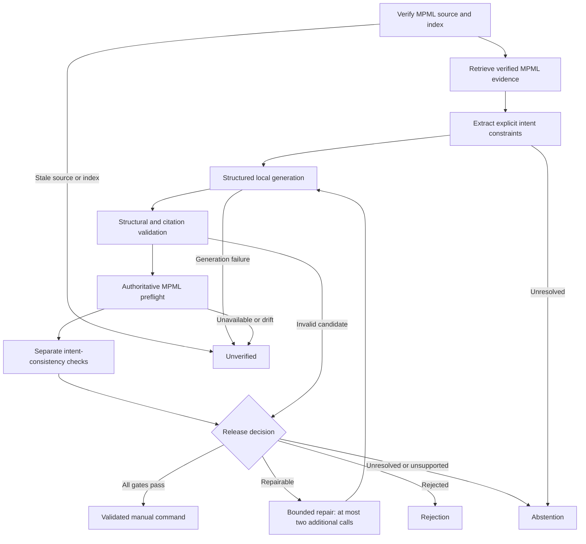

# Historical workflows and experimental retrieval

The read-only developer preview recommends `argus ask --agent-v2` for advisory work. This page preserves the original model-assisted workflows and their evaluation context.

## Ask for a cited MPML recipe

Use a configured MPML checkout whose interpreter can run both `mpml.spec` and
`mpml.preflight`. Start local Ollama on port 11434. Use
`OLLAMA_NO_CLOUD=1 ollama serve` when starting a dedicated instance. Install the
`llm` extra for `ask` and pull both local models before indexing or querying.

```bash
python -m pip install -e '.[llm]'
ollama pull nomic-embed-text
ollama pull qwen2.5-coder:7b
argus index --embed nomic-embed-text
argus ask --timeout 300 "How do I evaluate MR32 on USDJPY?"
```

Check the JSON for the intended `--strategy MR32` and `ACTIVE_PAIRS=USDJPY`, resolved
citations, and the original MPML preflight findings. A successful recipe has a
POSIX-shell-escaped `command` for **manual execution only**. Argus leaves execution and
intent unverified. Review the argv, overrides, and any warnings before using it,
and keep the same inherited environment if you decide to run it.

- `structural_validation` covers schema, citation membership, and the allowed argument
  and override shapes. MPML owns parsing and semantic checks.
- `preflight_validation` reports whether MPML accepted the candidate. The overall
  `verification` can still be `abstained`. Argus withholds the command when the
  proposed or inherited `DL_SIGNALS_ENABLED` value is nonempty and differs from
  `false` (case-insensitive), since preflight cannot confirm activation.
- `ask` exits 0 when it renders a command, 1 for a JSON rejection, abstention, or
  unverified result, and 2 for CLI/configuration errors.

The defaults are `qwen2.5-coder:7b`, hybrid retrieval, temperature 0, seed 42,
an 8192-token context, up to 1100 generated tokens, and a 180-second generation
timeout. Configure the model, temperature, seed, and timeout with `--model`,
`--temperature`, `--seed`, and `--timeout`. CPU-only inference can take minutes.
For an index built without embeddings, pass `--retrieval-mode lexical`. Rebuild
a stale index before asking.

The smoke fixture records M3 generation outcomes independently of the M2.5
retrieval benchmark. [M3 smoke fixture](../../eval/generation/README.md)

The architecture note describes how Argus handles model output, source evidence,
and preflight. [Trust boundary ADR](../adr/0003-structured-generation.md)

## M4 architecture

M3 remains the default single-pass workflow. M4B-2 connects the optional graph
to local generation, preflight, and bounded repair.

```bash
python -m pip install -e '.[llm,agent]'
argus ask "How do I evaluate MR32 on USDJPY?" --agent
```

The agent uses the same source configuration, index, and local model settings
as `ask`. It reserves at most three calls, including the first generation,
and keeps retrieval evidence and explicit constraints fixed during repair.
Each new candidate goes through the validation gates again. The JSON report
records the final disposition, source and index fingerprints, call and repair
counts, per-attempt findings, and end-to-end time. MPML diagnostics are preserved
as returned. Repair feedback excludes raw model output and bridge stderr.



The extractor covers narrow patterns. Otherwise reasonable wording can result
in an abstention, with the reason visible in the report. A released command is
for manual use. Explicit-intent consistency covers the extracted requirements.
Full semantic intent, experiment success, artifact loading, and DL activation
remain unverified. [Detailed graph and limits](../adr/0004-bounded-langgraph-orchestration.md)

## Retrieval experiments

Lexical retrieval uses BM25+ and preserves exact flag and environment tokens as well
as their component words. To compare it with cosine similarity and reciprocal rank
fusion, start Ollama on the default loopback port and use a locally installed embedding model.

```bash
ollama pull nomic-embed-text
argus index --embed nomic-embed-text
argus retrieve --mode embedding "How do artifact path overrides work?"
argus retrieve --mode hybrid "How do artifact path overrides work?"
argus retrieve --mode all "How do artifact path overrides work?"
```

`--mode all` returns the three ranked lists for the same query. Each list defaults to
five results. Only `argus index` writes the artifact or embeds the corpus. Embedding,
hybrid, and ablation queries send one query embedding request to the local Ollama
instance. Argus checks the stored model digest before using those vectors.

Retrieval checks the live Git SHA and dirty state, the spec hash, and the selected
Markdown hashes before returning hits. A changed revision or evidence file requires
rebuilding with `argus index`, including `--embed MODEL` if using embedding modes.
A dirty checkout can be indexed, with the dirty state visible in each citation.

### Synthetic hit@5

The held-out fixture contains six questions. A hit means the expected path and
heading appeared among the first five results.

| Ranking | Hit@5 |
| --- | ---: |
| Lexical BM25+ | 5/6 |
| Embedding cosine | 6/6 |
| Hybrid | 6/6 |

The fixture uses a synthetic spec, Markdown, and embedding responses. These scores
measure the retrieval pipeline on the fixture. The real MPML retrieval evaluation is recorded separately. [Retrieval evaluation](../../eval/retrieval/README.md)

```bash
python -m pytest -q -s tests/test_retrieval.py::test_held_out_hit_at_five
```
